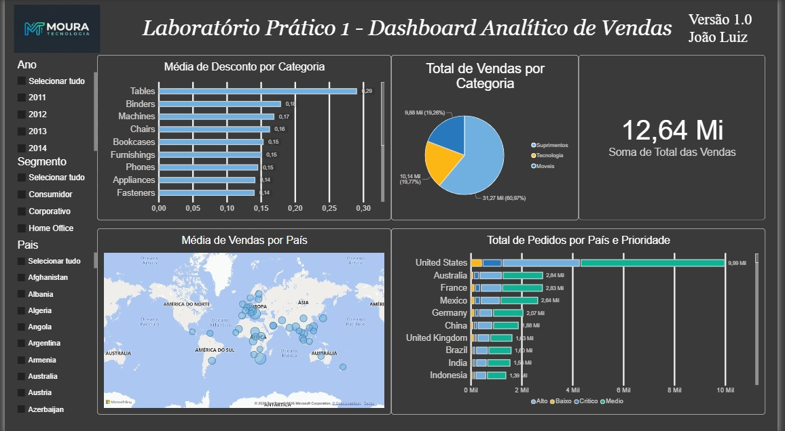

# 📊 Dashboard Analítico de Vendas Globais

## 🎯 Objetivo do Projeto
Desenvolvimento de um dashboard interativo no **Microsoft Power BI** para análise comercial e logística de vendas globais. O projeto consolida indicadores financeiros, volumetria por categorias e desempenho geográfico para apoiar a tomada de decisão estratégica.

---

## ❓ Perguntas de Negócio Respondidas
O painel foi estruturado para responder diretamente aos seguintes requisitos analíticos:

1. **Qual o valor total vendido?** — *R$ 12,64 Mi* (exibido em cartão de KPI principal).
2. **Quantas vendas foram realizadas por categoria de produto?** — Distribuição comparativa entre *Material de Escritório*, *Tecnologia* e *Móveis* (Gráfico de Colunas Agrupadas).
3. **Quantas vendas foram realizadas por país considerando a prioridade de entrega?** — Análise cruzada da volumetria por nação segmentada por criticidade logística (*Média*, *Alta*, *Crítica* e *Baixa*).
4. **Qual foi a média de desconto nas vendas por subcategoria de produto?** — Ranking detalhado identificando as linhas com maior concessão de descontos (ex.: *Mesas*, *Eletrodomésticos*, *Suprimentos*).
5. **Quais países tiveram maior média de valor de venda?** — Visualização geoespacial interativa (Mapa) destacando os mercados com maior ticket médio.

---

## ⚙️ Funcionalidades e Interatividade
* **Filtros Dinâmicos (Segmentadores):** Possibilidade de fatiar todos os visuais simultaneamente por **Ano**, **Segmento** (*Consumidor*, *Corporativo*, *Home Office*) e **País**.
* **Identidade Visual:** Layout desenvolvido em modo escuro (*Dark Mode*) com alto contraste, hierarquia de informação clara e identidade visual **Moura Tech Tecnologia**.

---

## 🛠️ Ferramentas e Tecnologias Utilizadas
* **Microsoft Power BI Desktop** (Modelagem de dados, ETL via Power Query e visualização).
* **DAX (Data Analysis Expressions)** para criação de medidas explícitas (Faturamento Total, Contagem de Vendas, Média de Descontos e Ticket Médio).

---

## 🚀 Como Visualizar o Projeto
1. Faça o download do arquivo `Dashboard_Vendas.pbix` disponível neste repositório.
2. Abra o arquivo utilizando o **Power BI Desktop** (versão gratuita).
3. Explore os filtros no cabeçalho superior para analisar cenários específicos.

---
*Desenvolvido por **João Luiz de Moura Junior**